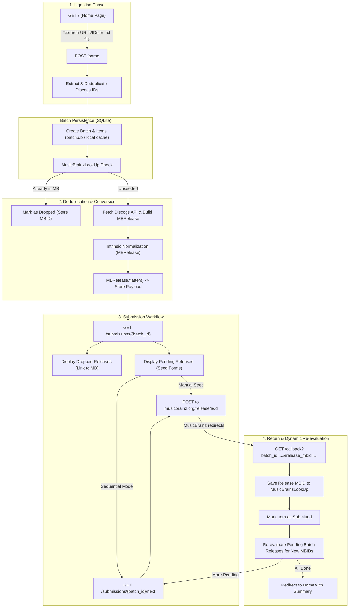

# Implementation Plan: Flask Web UI & Submission Controllers

## 1. Objective & Scope

Build out the complete web interface and submission workflow for **Discobrain** as specified in [README.md](../README.md) and guided by [AGENTS.md](../AGENTS.md).

The implementation will be carried out on a dedicated Git branch (`feature/flask-web-ui`) with atomic, incremental commits accompanied by comprehensive unit tests.

### Key Functional Requirements
1. **Setup & Ingestion:**
   - Display Discogs auth status and rate limit badge (60 req/min authenticated vs. 25 req/min unauthenticated).
   - Ingest Discogs release URLs or IDs via textarea or `.txt` file upload.
2. **Deduplication & Conversion:**
   - Pre-filter IDs against the local `MusicBrainzLookUp` cache and MusicBrainz `/ws/2/url`.
   - Exclude existing releases and list them with direct links to MusicBrainz.
   - Convert valid releases to `MBRelease` via `ReleaseConverter` (with intrinsic title/country/barcode normalization and language/script deduction).
3. **Submission View & Seeding:**
   - Render each pending release with a POST form targeting `https://musicbrainz.org/release/add` populated with flattened parameters (`MBRelease.flatten()`).
   - Include a `redirect_uri` for MusicBrainz to return the newly created `release_mbid`.
4. **Callback, Re-evaluation & Sequential Mode:**
   - Handle callback notifications (`/callback`), saving new release MBIDs into `MusicBrainzLookUp`.
   - Re-evaluate pending releases in the batch to link newly established artist/label MBIDs.
   - Support one-click automated sequential progression across the batch using auto-submit with a fallback "Proceed to Next Release" button.
   - Minimalist frontend (standard HTML forms, server-rendered Jinja2 templates, minimal JavaScript).

---

## 2. Architecture & Data Flow



---

## 3. Data Storage & Batch Management

### Challenge
Flask default client-side sessions are stored in browser cookies (4KB limit). A batch of 10–50 releases with full tracklists and flattened parameters easily exceeds 100KB, making client-side cookie storage unviable.

### Solution
Use a local SQLite database (leveraging SQLite already used by `MusicBrainzLookUp`) to store batch state:
- **`batches` table:** `id`, `created_at`, `status` (`processing`, `active`, `completed`).
- **`batch_items` table:**
  - `id`, `batch_id`, `discogs_id`
  - `status` (`pending`, `dropped`, `submitted`, `error`)
  - `mbid` (for dropped or newly seeded releases)
  - `title`, `artist`, `format`, `year`
  - `flattened_payload` (JSON-serialized dict from `MBRelease.flatten()`)
  - `error_message`

This is completely lightweight, uses the Python standard library `sqlite3`, requires no external dependencies, and persists state across browser tabs and sessions.

---

## 4. Incremental Feature Commit Plan

We will create a new branch: `feature/flask-web-ui` and work incrementally with focused commits:

### Feature 1: Test Harness & Foundation
- **Goal:** Fix test configuration, configure default secret key for dev/test, and set up base Jinja layout.
- **Changes:**
  - Add `app.secret_key = os.getenv("DISCOBRAIN_SECRET_KEY", "dev-secret-key-change-me")` to ensure sessions work in dev and tests without requiring manual `.env` exports.
  - Create pytest fixture in `test/conftest.py` with test app configuration and client.
  - Complete `discobrain/templates/base.html` with clean semantic HTML, navbar, flash messages block, and minimal responsive CSS.
- **Tests:** Verify existing tests pass (`test_auth.py`), and test base layout rendering.
- **Commit Message:** `feat(web): configure app secret key fallback, test harness, and base template`

### Feature 2: Batch SQLite Storage & Manager
- **Goal:** Implement persistent batch storage for queueing releases and tracking submission progress.
- **Changes:**
  - Create `discobrain/batch_store.py` (`BatchStore` class) with SQLite tables (`batches`, `batch_items`).
  - Methods: `create_batch()`, `get_batch()`, `add_items()`, `update_item_status()`, `get_pending_item()`, `recount()`.
- **Tests:** Add `test/test_batch_store.py` testing batch lifecycle, item status transitions, and serialization.
- **Commit Message:** `feat(batch): add SQLite batch store for tracking import submissions`

### Feature 3: Ingestion Controller & Home Page
- **Goal:** Ingest URLs/IDs via textarea or `.txt` file, extract IDs, and validate input.
- **Changes:**
  - Create `discobrain/templates/index.html` with:
    - Discogs auth status badge & OAuth connect / logout link.
    - Multiline textarea for URLs or IDs.
    - File upload input for `.txt` files.
    - Submit "Parse" button.
  - Update `discobrain/__init__.py`:
    - `GET /`: renders `index.html` with auth state.
    - `POST /parse`: parses text input or uploaded file, extracts unique Discogs IDs via `ReleaseConverter._discogs_id_extract()`, redirects to processing/submissions.
- **Tests:** Add `test/test_webapp.py` testing `GET /`, `POST /parse` with raw IDs, URLs, uploaded text files, and empty/invalid input errors.
- **Commit Message:** `feat(web): implement home page and input ingestion for URLs and text files`

### Feature 4: Deduplication & Conversion Pipeline
- **Goal:** Filter out releases already present in MusicBrainz and convert unseeded releases.
- **Changes:**
  - In `discobrain/__init__.py` (or dedicated service `discobrain/pipeline.py`):
    - Connect `MusicBrainzLookUp` to check if release URL already has an MBID.
    - Mark existing releases as `dropped`.
    - Fetch unseeded releases via `ReleaseConverter` with user's credentials (session or env).
    - Rely on intrinsic normalization in `MBRelease`.
    - Flatten to seed payload and store in `BatchStore`.
- **Tests:** Add tests in `test/test_webapp.py` with mocked Discogs API and `MusicBrainzLookUp` verifying pre-filter dropping and successful conversion.
- **Commit Message:** `feat(pipeline): integrate deduplication pre-filtering and release conversion`

### Feature 5: Submission View & MusicBrainz Seeding Forms
- **Goal:** Present the submission dashboard with one-click MusicBrainz release editor forms.
- **Changes:**
  - Create `discobrain/templates/submissions.html`:
    - Header showing batch progress (Pending, Dropped, Submitted).
    - Dropped releases section linking directly to `https://musicbrainz.org/release/{mbid}`.
    - Pending releases cards with release summary (title, artist, format, track count).
    - POST form targeting `https://musicbrainz.org/release/add` in a new tab with hidden fields from `MBRelease.flatten()`.
    - "Mark Done" button for manual submission reconciliation.
- **Tests:** Test `GET /submissions/<batch_id>` verifying form inputs, hidden field rendering, and dropped release links.
- **Commit Message:** `feat(web): add submission view with MusicBrainz seeding forms and dropped links`

### Feature 6: Return Callback, Entity Cache Update & Dynamic Re-evaluation
- **Goal:** Handle MusicBrainz submission return callbacks and dynamically refresh subsequent batch releases.
- **Changes:**
  - Add `redirect_uri` to seeded forms pointing to `/callback?batch_id=...&discogs_id=...`.
  - Add route `GET /callback`:
    - Extract `release_mbid` and `discogs_id`.
    - Save URL-to-MBID mapping in `MusicBrainzLookUp` SQLite cache.
    - Update `batch_item` status to `submitted`.
    - Re-evaluate remaining pending releases in `batch_store`: re-run `lookup.get_mbids()` to resolve newly submitted artists and labels.
- **Tests:** Test `/callback` endpoint with query parameters, verifying cache update, status update, and entity re-resolution.
- **Commit Message:** `feat(web): handle MusicBrainz return callback and dynamic entity re-evaluation`

### Feature 7: Automated Sequential Submission Mode & Flow Completion
- **Goal:** Implement the "Submit All Sequentially" flow that steps through each release automatically.
- **Changes:**
  - Add "Submit All Sequentially" button on submission view.
  - Route `GET /submissions/<batch_id>/next`:
    - Finds next pending release.
    - Renders `templates/seed_redirect.html`:
      - Standard POST form to `https://musicbrainz.org/release/add` with hidden seed parameters.
      - Auto-submit script: `document.getElementById('seed-form').submit();`.
      - Fallback button: "Proceed to Next Release (or click here if not automatically redirected)" so the workflow works smoothly even if JavaScript is disabled.
    - When MusicBrainz returns via `/callback`, if in sequential mode, redirect immediately to `/submissions/<batch_id>/next`.
    - When all releases are finished, redirect back to `/` with a flash completion banner.
- **Tests:** Test full end-to-end sequential submission cycle.
- **Commit Message:** `feat(web): implement automated sequential submission flow and completion cycle`

---

## 5. Verification & Quality Gates

Before each commit and upon task completion, run:
```bash
uv run poe validate
```
This ensures:
1. `pyrefly check`: Static type checking passes with zero errors.
2. `ruff check --fix`: Linting and formatting pass.
3. `pytest`: All new and existing unit tests pass offline with 100% mocked external HTTP requests.
